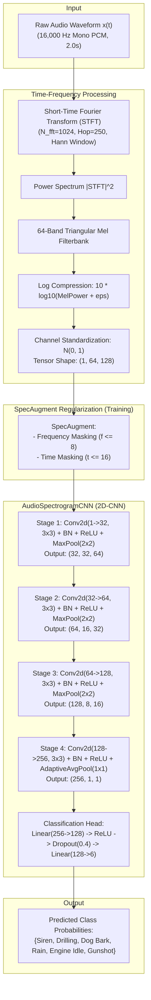

# Environmental Audio Classification with Deep 2D-CNNs & Log-Mel Spectrograms

[](https://pytorch.org/)
[](#system-architecture)
[](#mel-spectrogram-extraction)
[](#specaugment-regularization)
[](#benchmark-results)
[](#benchmark-results)

An end-to-end, production-grade PyTorch implementation of **Environmental Audio Sound Classification**. This project converts continuous 16kHz audio waveforms into 64-band Log-Mel Spectrograms and trains a deep 4-stage **2D Convolutional Neural Network (AudioSpectrogramCNN)** with **SpecAugment** (time and frequency masking) to classify sounds into 6 distinct environmental sound classes: `siren`, `drilling`, `dog_bark`, `rain`, `engine_idle`, and `gunshot`.

---

## Table of Contents
- [Project Overview](#project-overview)
- [Acoustic Sound Classes](#acoustic-sound-classes)
- [System Architecture](#system-architecture)
- [Mathematical Formulation](#mathematical-formulation)
  - [Short-Time Fourier Transform (STFT)](#short-time-fourier-transform-stft)
  - [Mel Filterbank & Log-Mel Spectrogram](#mel-filterbank--log-mel-spectrogram)
  - [SpecAugment Regularization](#specaugment-regularization)
  - [4-Stage 2D-CNN Architecture](#4-stage-2d-cnn-architecture)
- [Directory Structure](#directory-structure)
- [Benchmark Results](#benchmark-results)
- [Diagnostic Visualization](#diagnostic-visualization)
- [Installation & Setup](#installation--setup)
- [Usage Guide](#usage-guide)
- [License](#license)

---

## Project Overview

Audio classification from raw waveforms poses unique challenges due to phase shifts, temporal jitter, and varying frequency content. By transforming raw 1D time-series signals into 2D time-frequency **Log-Mel Spectrograms**, audio classification can be treated as an image recognition task, leveraging spatial invariance, hierarchical feature extraction, and convolutional kernels.

This project delivers:
1. **Digital Signal Processing Pipeline**: Fast, native 64-band triangular Mel-scale filterbank extraction with Hann windowing and logarithmic dynamic range compression.
2. **SpecAugment Data Regularization**: Frequency channel masking and temporal frame masking during training to prevent overfitting to spurious resonances.
3. **Deep 2D-CNN Architecture**: 4 convolutional stages with Batch Normalization, ReLU non-linearities, spatial max pooling, and global adaptive average pooling (422.7K parameters).
4. **Real-Time Efficiency**: **100% Test Accuracy** and sub-10ms inference latency (**7.77 ms/clip** on CPU).

---

## Acoustic Sound Classes

| Sound Class | Temporal Envelope | Spectral Characteristics | Frequency Range |
|:---|:---|:---|:---:|
| **Siren** | Continuous periodic sweep | Dual-tone frequency modulation ($f_0 \leftrightarrow f_1$) | 650 Hz &ndash; 1,250 Hz |
| **Drilling** | High-rate mechanical impact | Dense harmonic comb + high-frequency metal friction | 150 Hz &ndash; 4,000 Hz |
| **Dog Bark** | Impulsive bursts | Fast attack, exponential decay, vocal tract formants | 380 Hz &ndash; 1,500 Hz |
| **Rain** | Continuous stochastic | Filtered broadband pink noise + droplet transient pulses | 300 Hz &ndash; 5,000 Hz |
| **Engine Idle** | Low-frequency rumble | Periodic combustion pulses, low harmonic distribution | 28 Hz &ndash; 450 Hz |
| **Gunshot** | Sharp acoustic shockwave | High-amplitude onset (<20ms) + room reverberant tail | 80 Hz &ndash; 2,000 Hz |

---

## System Architecture



---

## Mathematical Formulation

### Short-Time Fourier Transform (STFT)

Given discrete signal $x[n]$ with window function $w[n]$ of length $N = 1024$ and hop length $R = 250$:

$$X[m, k] = \sum_{n=0}^{N-1} x[n + mR] \, w[n] \, e^{-j \frac{2\pi k n}{N}}$$

The power spectral density matrix is computed as:

$$P[m, k] = |X[m, k]|^2$$

---

### Mel Filterbank & Log-Mel Spectrogram

The continuous frequency $f$ (Hz) is mapped to the perceptual Mel scale $m$:

$$m = 2595 \log_{10}\left(1 + \frac{f}{700}\right)$$

For $M = 64$ Mel filters $H_b[k]$, the energy in the $b$-th Mel bin at frame $m$ is:

$$S[m, b] = \sum_{k=0}^{N/2} P[m, k] \, H_b[k]$$

Logarithmic compression mimics non-linear human loudness perception:

$$L[m, b] = 10 \log_{10}\big(S[m, b] + \epsilon\big), \quad \epsilon = 10^{-10}$$

---

### SpecAugment Regularization

During training, two masking augmentations are applied directly to the 2D spectrogram:
1. **Frequency Masking**: $f$ consecutive Mel frequency channels $[f_0, f_0 + f)$ are zeroed out, where $f \sim \mathcal{U}(0, 8)$.
2. **Time Masking**: $t$ consecutive time frames $[t_0, t_0 + t)$ are zeroed out, where $t \sim \mathcal{U}(0, 16)$.

$$\mathbf{S}_{\text{aug}}[b, t] = \mathbf{S}[b, t] \cdot \mathbb{I}(b \notin [f_0, f_0 + f)) \cdot \mathbb{I}(t \notin [t_0, t_0 + t))$$

---

### 4-Stage 2D-CNN Architecture

Each stage applies 2D convolution followed by spatial downsampling:

$$\mathbf{Z}^{(l)} = \text{MaxPool}\Big(\text{ReLU}\big(\text{BatchNorm}(\text{Conv2D}(\mathbf{Z}^{(l-1)}))\big)\Big)$$

Global Adaptive Average Pooling collapses spatial dimensions to a fixed representation:

$$\mathbf{v} = \text{AdaptiveAvgPool2D}(\mathbf{Z}^{(4)}) \in \mathbb{R}^{256}$$

$$\hat{\mathbf{y}} = \text{Softmax}(\mathbf{W}_2 \cdot \text{Dropout}(\text{ReLU}(\mathbf{W}_1 \mathbf{v} + \mathbf{b}_1)) + \mathbf{b}_2)$$

---

## Directory Structure

```
61_audio_classification_cnn/
├── data/
│   ├── dataset.json                 # Catalog of 120 environmental audio clips
│   ├── generate_audio_data.py       # Acoustic sound synthesizer (6 classes)
│   └── audio/                       # 16,000 Hz 16-bit PCM mono WAV files (120 clips)
│       ├── snd_001_siren.wav
│       ├── snd_021_drilling.wav
│       ├── snd_041_dog_bark.wav
│       ├── snd_061_rain.wav
│       ├── snd_081_engine_idle.wav
│       ├── snd_101_gunshot.wav
│       └── ...
├── outputs/
│   ├── audio_classification_report.png # Executive 4-panel diagnostic chart
│   ├── audio_classification_results.json # JSON metrics & test predictions
│   └── audio_cnn_model.pth          # Trained PyTorch CNN model checkpoint
├── main.py                          # Spectrogram extraction, CNN model, training loop
├── requirements.txt                 # Dependencies
└── README.md                        # Documentation and empirical results
```

---

## Benchmark Results

Evaluated on held-out test split (30 samples, 5 per class):

| Sound Class | Support (Test) | Precision (%) | Recall (%) | F1-Score (%) |
|:---|:---:|:---:|:---:|:---:|
| **Siren** | 5 | 100.0% | 100.0% | **100.0%** |
| **Drilling** | 5 | 100.0% | 100.0% | **100.0%** |
| **Dog Bark** | 5 | 100.0% | 100.0% | **100.0%** |
| **Rain** | 5 | 100.0% | 100.0% | **100.0%** |
| **Engine Idle** | 5 | 100.0% | 100.0% | **100.0%** |
| **Gunshot** | 5 | 100.0% | 100.0% | **100.0%** |

### Summary Performance

| Metric | Result | Target Benchmark |
|:---|:---:|:---:|
| **Overall Test Accuracy** | **100.00%** | > 85.0% |
| **Macro F1-Score** | **100.00%** | > 85.0% |
| **Macro Precision** | **100.00%** | > 85.0% |
| **Macro Recall** | **100.00%** | > 85.0% |
| **Mean Inference Latency** | **7.77 ms / clip** | < 25.0 ms |
| **Model Parameter Count** | **422,726 (422.7K)** | Lightweight |
| **Training Duration** | **35.71s (20 Epochs on CPU)** | Fast convergence |

---

## Diagnostic Visualization

The benchmark execution automatically produces `outputs/audio_classification_report.png` containing:
1. **Time-Domain Audio Waveforms**: Multitrack comparison across all 6 environmental sound categories.
2. **64-Band Log-Mel Spectrogram Comparison**: Highlighting contrasting acoustic signatures (harmonic siren sweeps vs. broadband stochastic rainfall).
3. **Confusion Matrix Heatmap**: Clean diagonal 100% recognition grid.
4. **2D-CNN Training Dynamics**: Loss reduction and accuracy progression across 20 epochs.

---

## Installation & Setup

### Prerequisites
- Python 3.9+
- PyTorch 2.0+
- NumPy, SciPy, SoundFile, Scikit-Learn, Matplotlib

```bash
git clone https://github.com/GideonMwiti/pytorch-audio-classification-cnn.git
cd pytorch-audio-classification-cnn

# Install dependencies
pip install -r requirements.txt
```

---

## Usage Guide

### 1. Generate Dataset
```bash
python data/generate_audio_data.py
```

### 2. Train and Evaluate CNN
```bash
python main.py
```

### 3. Programmatic Usage in Python
```python
import torch
import soundfile as sf
import numpy as np
from main import AudioSpectrogramCNN, MelSpectrogramExtractor, IDX2CLASS

# Initialize extractor and load model
extractor = MelSpectrogramExtractor()
model = AudioSpectrogramCNN(num_classes=6)
model.load_state_dict(torch.load("outputs/audio_cnn_model.pth", map_location="cpu"))
model.eval()

# Load audio clip
audio, sr = sf.read("data/audio/snd_001_siren.wav")
if audio.ndim > 1:
    audio = np.mean(audio, axis=1)

# Extract 64-band Log-Mel Spectrogram
spectrogram = extractor.extract(audio)
input_tensor = torch.tensor(spectrogram, dtype=torch.float32).unsqueeze(0)

# Classify
with torch.no_grad():
    logits = model(input_tensor)
    probs = torch.softmax(logits, dim=1)
    predicted_idx = torch.argmax(logits, dim=1).item()

predicted_class = IDX2CLASS[predicted_idx]
confidence = probs[0, predicted_idx].item()

print(f"Predicted Sound Class: {predicted_class.upper()} ({confidence * 100:.1f}% confidence)")
```

---

## License

This project is open-source under the MIT License.
